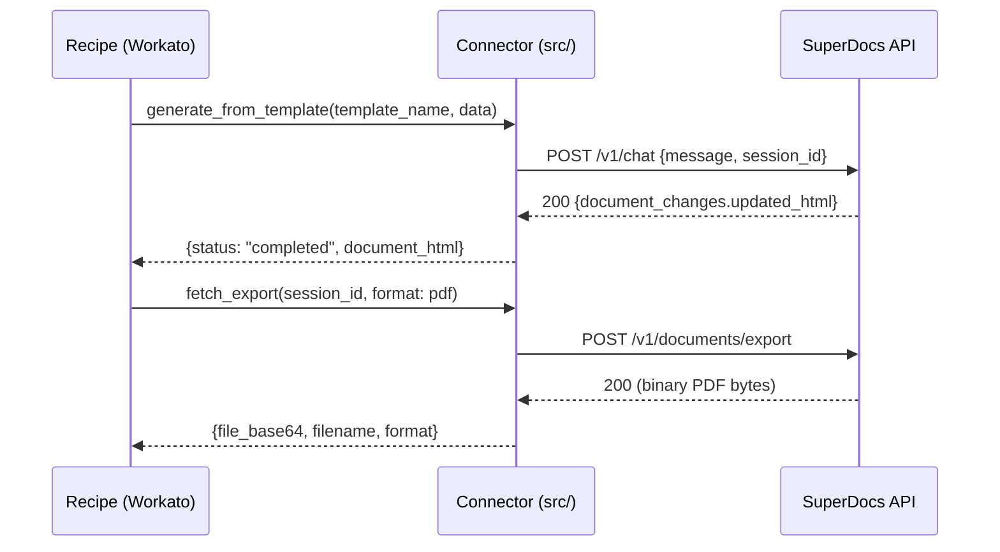
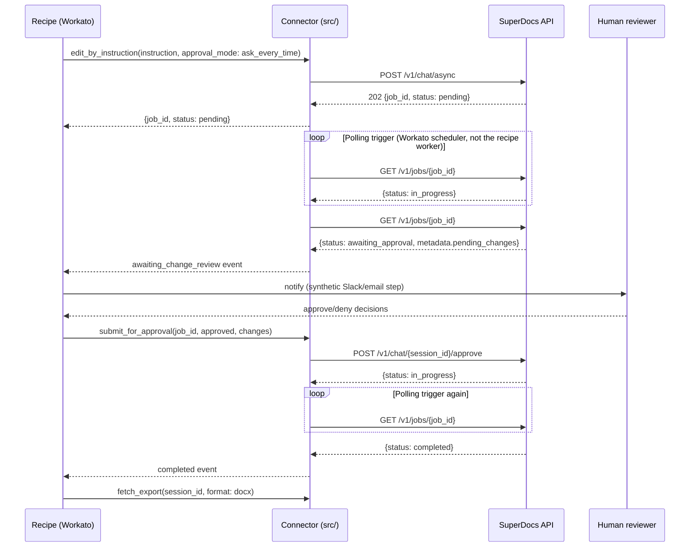
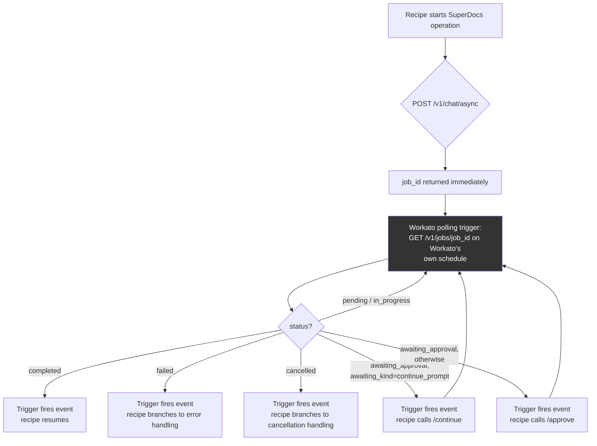
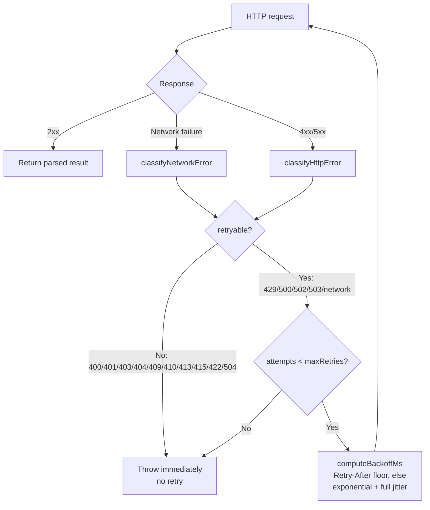

# Architecture

## Layering

```
connectors/workato/connector.rb   <- platform adapter (Ruby, Workato SDK)
        |
        | thin wrapper: input_fields -> operation call -> output_fields
        v
src/operations/*.js               <- platform-agnostic operation logic
        |
        v
src/client.js (SuperDocsClient)   <- typed HTTP client (auth, endpoints)
        |
        v
src/retry.js + src/errors.js      <- retry contract + typed error model
        |
        v
   SuperDocs REST API (api.superdocs.app)
```

The platform adapter is intentionally thin: it converts Workato's
`input_fields` hash into the operation module's typed input, calls the
operation, and converts the result back into `output_fields`. All actual
business logic (validation, retry, error classification, the
proposed-changes double-parse handling) lives in `src/`, which is fully
tested independent of any platform — see `tests/`. This means a future
Boomi, MuleSoft, or Tray adapter would be a similarly thin wrapper around
the same `src/` logic, not a reimplementation.

## Request flow — synchronous path (Recipe 1)



## Request flow — asynchronous + HITL path (Recipe 2)



## Async/callback design — the honest version



**SuperDocs has no webhook/callback-registration endpoint** (verified —
see `docs/api-notes.md`). The box above labeled "Workato polling
trigger" is what actually satisfies "long-running operations use
callbacks/webhooks rather than blocking workers": Workato's own
scheduler does the waiting, off the recipe's execution thread, and the
recipe only re-enters when there's a real state change — the same
externally-observable effect a webhook would produce, built on the
mechanism SuperDocs actually offers (polling), not a fabricated one.

## Retry / error path



## Folder layout

```
extensions/<github-username>/superdocs-enterprise-connector/
├── README.md
├── TASK.md
├── PROGRESS.md
├── docs/
│   ├── architecture.md        <- this file
│   └── api-notes.md           <- source citations for every API fact relied on
├── package.json                <- zero runtime deps, node:test only
├── src/                         <- platform-agnostic core (tested)
│   ├── client.js
│   ├── errors.js
│   ├── retry.js
│   ├── schema.js
│   ├── index.js
│   └── operations/
│       ├── generateFromTemplate.js
│       ├── editByInstruction.js
│       ├── submitForApproval.js
│       ├── pollForCompletion.js
│       └── fetchExport.js
├── tests/                       <- 83 passing tests, mocked HTTP, no live API key
│   ├── errors.test.js
│   ├── retry.test.js
│   ├── client.test.js
│   ├── operations.test.js
│   ├── second-run.test.js       <- two distinct fixtures, same code path
│   ├── fixtures/
│   ├── mocks/
└── connectors/
    └── workato/
        ├── connector.rb         <- the actual platform adapter
        ├── smoke_test.rb        <- stub-based lambda smoke test (real Ruby)
        ├── VALIDATION.md        <- honest validated-vs-not breakdown
        └── recipes/
            ├── recipe-1-template-to-export.md
            ├── recipe-2-edit-approve-export.md
            └── recipe-3-event-driven-callback.md
```
